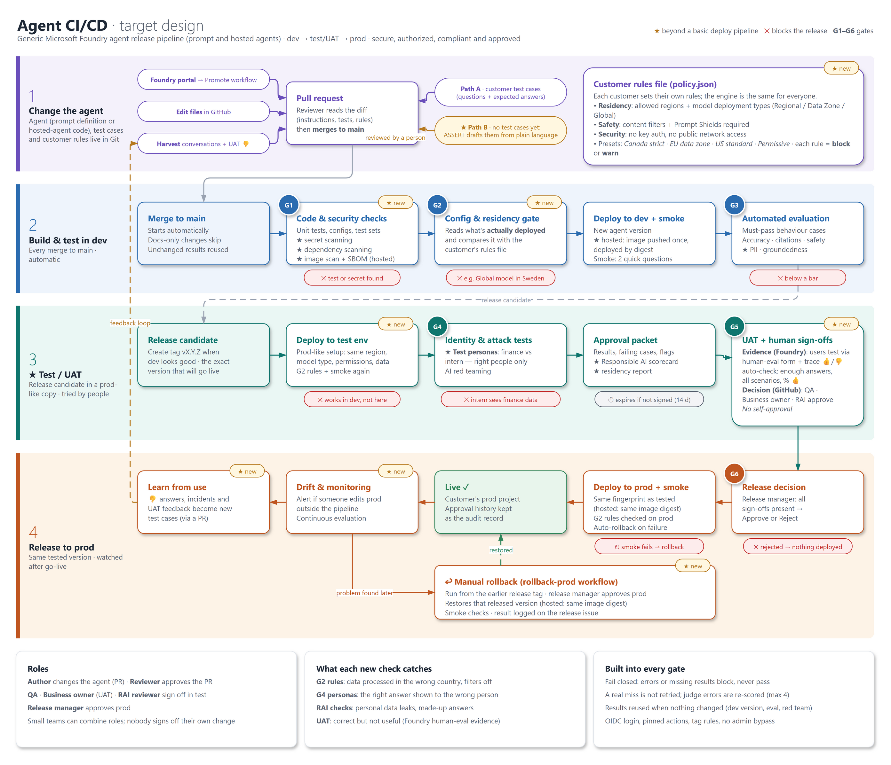

# Foundry agent release pipeline

A reusable GitHub Actions pipeline that takes a Microsoft Foundry agent (prompt or hosted) from dev, through a test/UAT project, to production. On the way the agent passes security, data-residency, quality, Responsible AI, red-team and human gates. Every gate fails closed: an error or a missing result blocks the release, never lets it through.



*The target design. To change it, edit [docs/release-pipeline.drawio](docs/release-pipeline.drawio) and re-export the PNG. Identity persona tests, continuous evaluation and ASSERT-drafted test cases are planned, not built yet (see [Scope and limitations](#scope-and-limitations)).*

```
PR / push ──► G1 code & security ──► G2 residency + deploy dev ──► G3 evaluation (quality + RAI)
release tag ──► G2 + deploy test ──► G4 AI red team ──► approval packet + RAI scorecard
            ──► G5 UAT ratings + QA / business / RAI sign-offs ──► G6 release decision ──► G2 + deploy prod + smoke + auto-rollback
daily       ──► prod drift check
on demand   ──► rollback-prod: release manager approves ──► an earlier released version restored + smoke
```

| Gate | What it checks | When it runs |
|---|---|---|
| G1 Code & security | secret scan (gitleaks), dependency scan (pip-audit), unit tests, config rendering, rule-file validation; hosted agents: image build, vulnerability scan (Trivy) and SBOM | every PR and push |
| G2 Config & residency | the environment's Azure setup against the rules in `policy.json` (presets: Canada strict, EU data zone, US standard, permissive; block or warn per rule) | before every deploy |
| G3 Evaluation | Foundry evaluation: must-pass behavior and privacy cases, answer correctness, citations, groundedness, PII leaks, protected material | push to `main`, release tags (reused when unchanged) |
| G4 Red team | Foundry AI Red Teaming of the release candidate in the test project | release tags (reused when unchanged) |
| G5 UAT + sign-offs | testers' ratings of the exact release candidate in Foundry (human evaluation / trace 👍👎), then QA, business-owner and RAI approvals | release tags |
| G6 Release decision | all sign-offs present and recent, then the release manager approves `prod` | before every prod deploy |
| Rollback | automatic when prod fails its smoke checks; on demand with `my-agent-rollback-prod.yml` (release manager approves, restores an earlier released version) | prod deploy failure; on demand |

That is the default shape. Each agent's [`pipeline.yaml`](cicd/agents/my-agent/pipeline.yaml) can drop the test environment, red teaming or UAT, change the sign-off roles, residency preset and regions, and the schedules. `python -m agent_cicd.generate` turns it into the agent's workflows, and G1 fails if they drift apart. See [Shaping the pipeline](cicd/README.md#shaping-the-pipeline-pipelineyaml).

## Contents

- [cicd/](cicd/): agent-as-code, residency rules, evaluation datasets, pass bars, the gate CLIs and tests. **Start with [cicd/README.md](cicd/README.md)** for setup, roles and the runbook.
- [cicd/agents/my-agent/](cicd/agents/my-agent/): the prompt-agent template. Values in `<angle brackets>` are placeholders to replace. Its `pipeline.yaml` describes the pipeline the agent goes through.
- [cicd/agents/my-hosted-agent/](cicd/agents/my-hosted-agent/): the hosted-agent template (your code and `Dockerfile` go in `src/`).
- [.github/workflows/](.github/workflows/): generated from each agent's `pipeline.yaml`: the release pipeline (`my-agent-release.yml`), manual prod rollback (`my-agent-rollback-prod.yml`), the prod drift check (`my-agent-prod-drift-check.yml`), portal-to-PR promotion (`my-agent-promote-portal-agent.yml`) and the trace harvest that proposes new test cases from real conversations (`my-agent-harvest-traces.yml`). The reusable deploy workflow (`agent-deploy.yml`) is shared by every agent and not generated.
- [docs/release-pipeline.drawio](docs/release-pipeline.drawio): the pipeline design (open it at [app.diagrams.net](https://app.diagrams.net)); [docs/release-pipeline.png](docs/release-pipeline.png) is the exported image shown above.

## Getting started

1. **Use this repo as a template** (or fork it) for your agent.
2. **Describe your agent.** For a prompt agent, edit [cicd/agents/my-agent/](cicd/agents/my-agent/): instructions, tools and the per-environment configs. For a hosted (container) agent, start from [cicd/agents/my-hosted-agent/](cicd/agents/my-hosted-agent/), put your code and `Dockerfile` in its `src/` folder and copy `my-agent/pipeline.yaml` into it. Rename the folder to your agent's name if you like: it names the workflows and release tags. The pipeline reads `kind` from `agent.json` and picks the matching build and deploy path.
3. **Shape the pipeline** in the agent's `pipeline.yaml`: test environment or not, red teaming, sign-off roles and UAT, residency preset and regions, schedules. Then run `cd cicd && python -m agent_cicd.generate` and commit the generated workflows.
4. **Write your test cases** in `eval/dataset.jsonl`: keep the generic behavior cases, replace the placeholder document questions with real ones, and raise `min_cases` in `eval/thresholds.json` to 100 or more.
5. **Set up Azure and GitHub** (projects, identities, environments): see [One-time setup](cicd/README.md#one-time-setup).
6. **Release:** merge to `main` for dev and evaluation, then push a tag such as `my-agent-v1.0.0` to run the full release.

Run the offline checks locally:

```bash
cd cicd
python -m venv .venv && . .venv/bin/activate   # Windows: .venv\Scripts\activate
pip install -r requirements.txt pytest
python -m pytest tests -q
```

Live gates need `az login` (or OIDC in Actions) with the **Foundry User** role on the target project. No endpoints are committed: copy [cicd/.env.example](cicd/.env.example) to `cicd/.env` for local runs, and set the same names as GitHub Environment secrets for Actions.

## Scope and limitations

- **Prompt and hosted agents.** Hosted agents are built into one container image, scanned, and promoted by digest, so prod runs the exact image that passed test. See [Hosted agents](cicd/README.md#hosted-agents).
- **Hosted path not yet proven against live Azure.** It is unit-tested and dry-run validated. Run one hosted release through a non-production Foundry project first and check the items in [To verify on the first live run](cicd/README.md#to-verify-on-the-first-live-run).
- **Not built yet:** identity persona tests (who can see what, through the agent's tools), continuous evaluation of prod traffic, and generating test cases from plain-language criteria for teams without a dataset.
- **Thresholds are starting points.** Agree the pass bars, red-team limits and residency rules with the agent's owners and Responsible AI reviewers before the first production release.
